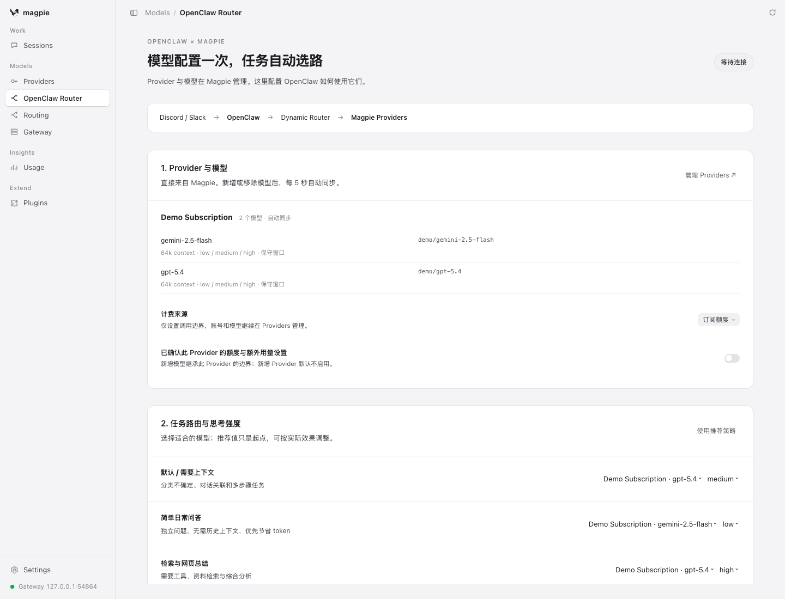

# Connect a model / 连接模型

After local setup, build Magpie and open the router console. / 完成本地初始化后，构建 Magpie 并打开路由控制台。

### ▶ Run / 操作

```sh
npm run toolchain:pnpm -- run magpie:setup
npm run toolchain:pnpm -- run router:ui
```

### 🔎 Check / 核对

In Providers, configure the provider and model once. In OpenClaw Router, select the model and fallback. Check the synced model before enabling optional dynamic routing. / 在 Providers 中配置供应商和模型，再到 OpenClaw Router 选择模型与回退项。确认模型同步后，再考虑开启动态路由。



📋 [Full procedure and configuration / 完整操作与配置](../agent/runbooks/model-router-quickstart-zh.md) · [Human handbook / 阅读导航](README.md)
