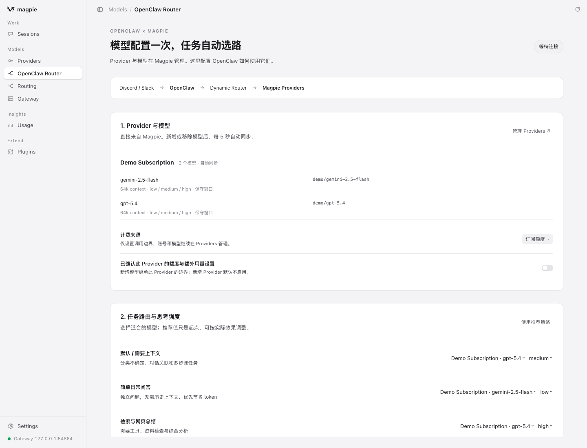
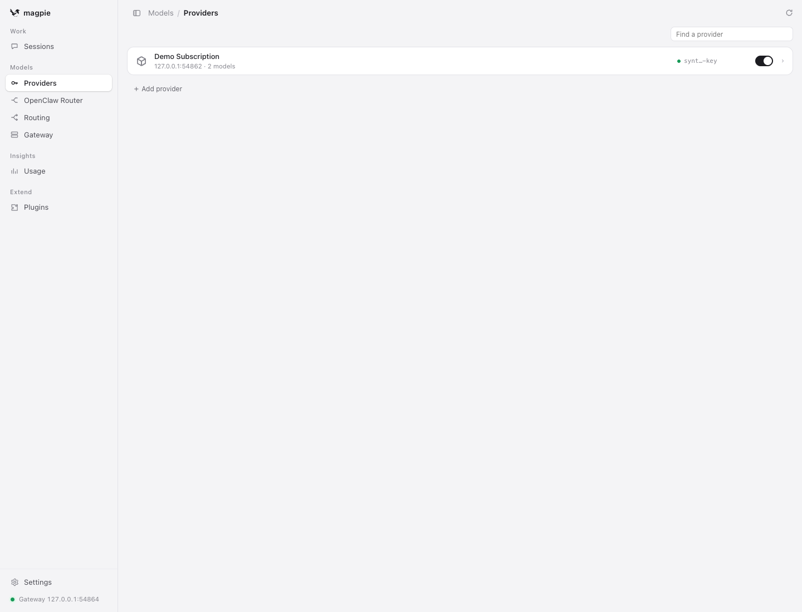
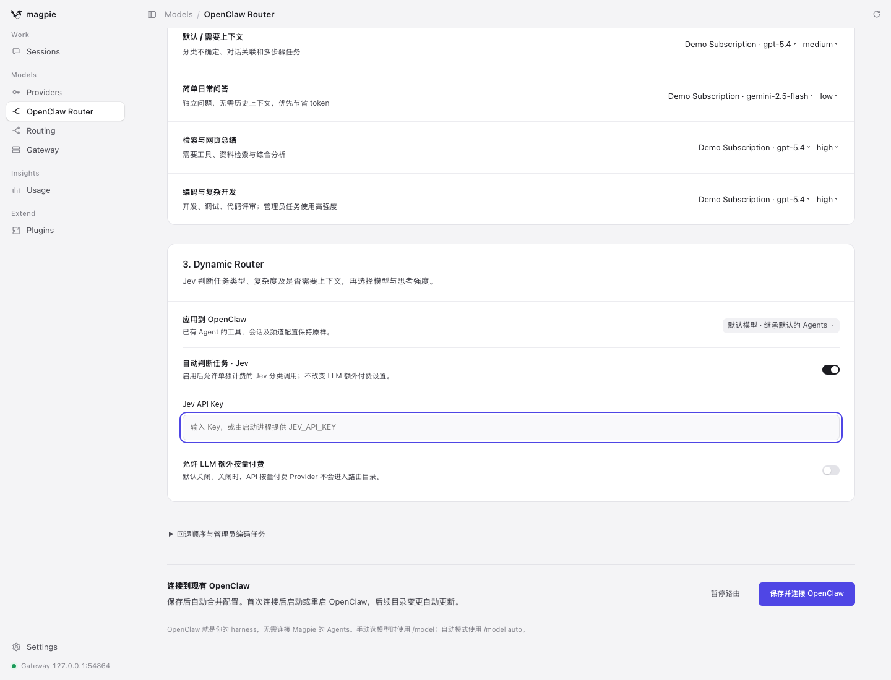

# Model Router 与 Dynamic Router 中文快速上手

**Provider 和模型只在 Magpie 配置一次。** 插件读取 Magpie 的模型目录，自动同步到 OpenClaw；
你只需在新增的 **OpenClaw Router** 页面设置任务策略、思考强度和回退。
OpenClaw 本身就是 harness，无需在 Magpie 的 Agents 页面连接 Codex、Claude Code 或其他客户端。

所有命令在本仓库根目录执行，统一使用 npm 包装器，无需全局安装 pnpm 或修改 `PATH`。

| 组件 | 负责什么 |
| --- | --- |
| Magpie 原生 **Providers** | Provider 登录、Key、模型开关、模型能力与账号刷新 |
| 新增 **OpenClaw Router** 页面 | 自动同步、任务与模型的对应关系、思考强度、计费边界、Jev 配置 |
| OpenClaw | Agent、会话、Discord / Slack、工具调用与任务执行 |
| Dynamic Router / Jev | 判断当前任务的复杂度、类型和上下文需求，选择已允许的模型及思考强度 |

## 1. 准备项目依赖

已有本项目的 OpenClaw 和 Magpie 时，可直接进入下一步。
首次安装先按 [Setup 工具链准备](setup.md#prerequisites)安装项目内 Node 和 pnpm，再执行：

```sh
git submodule update --init --recursive
npm run toolchain:pnpm -- install --frozen-lockfile
npm run toolchain:pnpm -- --dir vendor/openclaw install --frozen-lockfile
npm run toolchain:pnpm -- --dir vendor/openclaw build
npm run toolchain:pnpm -- run setup:local
npm run toolchain:pnpm -- run magpie:setup
```

Magpie 的源码和可执行文件放在项目 `.toolchain`，私有账号资料放在 `runtime/magpie`。
不需要全局安装 Magpie。版本继续由仓库锁定，升级见 [Magpie 升级流程](magpie-upgrade-zh.md)。

## 2. 打开集成配置界面

首次从旧版迁移时，先在原终端停止使用相同私有目录的旧 Magpie UI 或 managed 网关。
启动新的统一入口：

```sh
npm run toolchain:pnpm -- run router:ui
```

下面的旧命令现在也打开同一个集成界面：

```sh
npm run toolchain:pnpm -- run magpie:ui
```

浏览器自动打开；若未打开，使用终端输出的完整本地链接。链接含本次会话凭据，不要分享。
界面默认在 `127.0.0.1:3431`，模型网关在 `127.0.0.1:3425`。保持这个终端运行。
Magpie 配置页面和模型网关由同一进程服务，配置时无需来回停止、切换网关。



截图使用隔离的模拟 Provider 演示真实界面，不包含真实账号或凭据。模型名称以你接入的 Provider 为准。

## 3. 在 Magpie 配置 Provider 和模型

点击左侧 **Providers**，或 Router 页面中的 **管理 Providers**。
继续使用 Magpie 原生的登录、添加 API Provider、模型开关和能力设置。



- 在 Magpie 添加账号或 API Provider，完成登录或填入该 Provider 的凭据。
- 启用需要给 OpenClaw 使用的文本模型。
- 如需调整模型的上下文窗口或思考能力，也在 Magpie 中修改。
- 返回左侧 **OpenClaw Router**，模型会自动出现，**无需复制 Provider、模型 ID 或窗口配置**。

Magpie 的 **Routing** 页面保留原有用途。OpenClaw 的任务分类与回退在 **OpenClaw Router** 配置；
不要把 Magpie routing group 当作 OpenClaw 模型导入。
Provider 自身若配置了内部回退，Router 会先排除它，并在页面提示；请在 Providers 移除内部回退，
再在 Router 中设置统一的回退顺序。

## 4. 配置 Model Router，连接 OpenClaw

在 **OpenClaw Router** 中：

1. 为每个要使用的 Provider 选择计费来源：**订阅额度**、**Coding Plan** 或 **API 按量付费**，
   并确认额度与额外用量设置。这是插件的调用边界，不是第二次配置 Provider 凭据。
2. 在“任务路由与思考强度”选择模型。下拉列表和思考强度均来自 Magpie；推荐值可直接作为起点。
3. 选择“应用到 OpenClaw”的范围：默认模型，或指定的现有 Agent。
4. 点击 **保存并连接 OpenClaw**。

| 策略 | 用途 | 常见配置方向 |
| --- | --- | --- |
| 默认 / 需要上下文 | 分类不确定、对话关联、多步骤任务 | 能力较强的通用模型，medium 或 high |
| 简单日常问答 | 独立问题，不需要历史上下文 | Flash 等轻量模型，较低思考强度 |
| 检索与网页总结 | 检索、工具调用、综合分析 | 能力较强的模型 |
| 编码与复杂开发 | 开发、调试、代码评审 | 支持 high 的模型；管理员编码任务使用高强度 |

默认禁止额外按量付费；Jev 分类费用单独控制，不会打开 LLM 的付费开关。
新增模型继承已确认 Provider 的计费边界；新增 Provider 默认等待确认。
Coding Plan 仅进入编码路径，不能作为通用问答的默认策略。
默认策略必须使用支持 `medium` 或 `high` 的模型；只有 `off` / `low` 模型时，控制台会提示原因，
不会发布无法执行的 `auto` 配置。轻量模型仍可用于简单问答策略和手动选择。
计费标签来自你的设置，不代表插件已经查询或验证了 Provider 的实际账单。

保存操作自动生成精确模型白名单的 Magpie Gateway Key，并合并
`runtime/openclaw/openclaw.json`。现有 Agent、工具和频道配置保留；不再手工生成、复制和合并 JSON。
首次修改前的完整配置备份为 `runtime/openclaw/openclaw.before-router-console.json`，其中可能包含敏感配置，
只保存在本地。

在另一个终端启动 OpenClaw；已经运行时，在其原终端停止后重启一次：

```sh
npm run toolchain:pnpm -- openclaw gateway run
```

首次连接、变更 Jev Key 或变更启动环境后需要重启 OpenClaw，以载入本地凭据。
后续目录与策略更新由 OpenClaw 配置重载机制应用；若你的 OpenClaw 配置关闭了自动重载，按其设置重启。

## 5. 启用 Dynamic Router



1. 打开“自动判断任务 · Jev”开关。这允许单独计费的 Jev 分类请求。
2. 填写 Jev API Key；也可由启动进程提供 `JEV_API_KEY`。已保存的 Key 不回显，留空保留。
3. 按需展开“回退顺序与管理员编码任务”，设置允许的自动回退顺序。
4. 填入管理员的平台身份，格式为 `channel/accountId/senderId`，每行一个；
   例如 `discord/default/YOUR_DISCORD_USER_ID`。管理员编码任务需要至少一条 high 路由。
5. 保存后，首次配置 Key 时重启 OpenClaw。

Key 保存在权限为 0600 的本地私有文件；OpenClaw 配置只引用环境变量，
插件不会把 Jev Key 写入模型目录或发给 LLM。
关闭动态模式后，`auto` 使用配置的默认策略。
Jev 超时、不可用、判断不确定或任务需要额外上下文时，使用能力较强的默认策略。
控制台在保存前验证默认策略是否支持 `medium` 或 `high`。直接手工修改配置时，
运行时仍会阻止不安全的低强度自动兜底。用 `/model` 明确手动选择模型不受此自动判断限制。

## 6. 在 Discord / Slack 使用

在 OpenClaw 原生模型选择器中选择 **rein-magpie/auto**，开始自动路由。
隔离版 Rein Discord 也支持：

| 命令 | 行为 |
| --- | --- |
| `/model` | 查看可选模型和当前选择 |
| `/model auto` | Dynamic Router 自动选路；关闭 Jev 时使用默认策略 |
| `/model quick` | 固定简单问答策略 |
| `/model general` | 固定通用策略 |
| `/model research` | 固定检索与总结策略 |
| `/model code` | 固定编码策略 |

手动选定策略保持锁定，不会因失败而自动换模型。自动模式才会使用显式配置的回退列表。
Slack 使用其 OpenClaw 原生模型选择入口。对话、工具、成员隔离规则继续由 OpenClaw 执行。

可选的 `rein_route_status` 工具可查看当前会话的 Provider、模型、思考强度和计费来源；
按 [状态工具配置](unified-subscription-access.md#authentication-and-billing-evidence) 将它加入 Agent 工具允许列表。
Magpie **Routing / Usage** 可查看网关侧的实际请求记录。配置的计费标签与观察到的实际模型分别展示。

## 7. 后续维护

- **添加、停用或删除模型：** 只在 Magpie Providers 修改。控制台运行期间每 5 秒检查一次，并在原生 UI 保存后触发同步。
- **默认模型被删除：** 从剩余支持 `medium` / `high` 的模型重新生成默认策略；没有合格模型时暂停 Key，保留上次的 OpenClaw 配置，页面显示原因。恢复合格模型后自动重新同步。
- **新增 Provider：** 目录自动发现；确认其计费边界后才进入调用白名单。
- **修改任务策略、思考强度或回退：** 在 OpenClaw Router 页面保存即可。
- **暂停 OpenClaw 路由：** 点击“暂停路由”，停用插件自己的 Key；Magpie 页面继续运行。再次保存可恢复。
- **停止整个本地模型服务：** 在 Router Console 终端按 Ctrl-C。网关停止后，OpenClaw 的这些路由暂不可用。

如需恢复接入前的 OpenClaw 配置，先停止 OpenClaw 和 Router Console，再执行：

```sh
cp -p runtime/openclaw/openclaw.before-router-console.json runtime/openclaw/openclaw.json
```

备份只在首次接入时生成；恢复它也会恢复该时点的其他配置，执行前保留你后续所需的改动。

### 常用命令

| 命令 | 用途 |
| --- | --- |
| `npm run toolchain:pnpm -- run router:ui` | 统一配置入口：Magpie Providers + OpenClaw Router |
| `npm run toolchain:pnpm -- run router:ui --no-open` | 不自动打开浏览器，使用终端链接 |
| `npm run toolchain:pnpm -- run magpie:ui` | 同上，保留已有命令习惯 |
| `npm run toolchain:pnpm -- run magpie:ui:native` | 仅原生 Magpie UI，用于旧版手工配置或排查；与 Console 错开运行 |
| `npm run toolchain:pnpm -- run magpie:setup --check` | 检查锁定版本与二进制摘要 |
| `npm run toolchain:pnpm -- openclaw plugins inspect rein-router --runtime --json` | 检查插件是否载入 |
| `npm run toolchain:pnpm -- openclaw plugins doctor` | 插件诊断 |
| `npm run toolchain:pnpm -- openclaw gateway health --port 18791` | 检查 OpenClaw；端口按本地配置调整 |
| `npm run toolchain:pnpm -- run check` | 仓库检查 |
| `npm run toolchain:pnpm -- exec node --test tests/router-console.test.mjs` | 同步与配置边界测试 |
| `npm run toolchain:pnpm -- run verify:router-console` | 用真实 Magpie 和隔离模拟 Provider 验证页面、目录与工具调用 |

旧版精细配置、独立 managed 生命周期和手工 JSON 片段仍可使用，见[详细指南](unified-subscription-access.md)。
集成界面不会修改 Magpie 上游源码；页面适配基于锁定版本的原生 kernel、UI kit 和本地 API，
升级时需运行 UI 验证。截图重新生成方式见[升级流程](magpie-upgrade-zh.md)。
